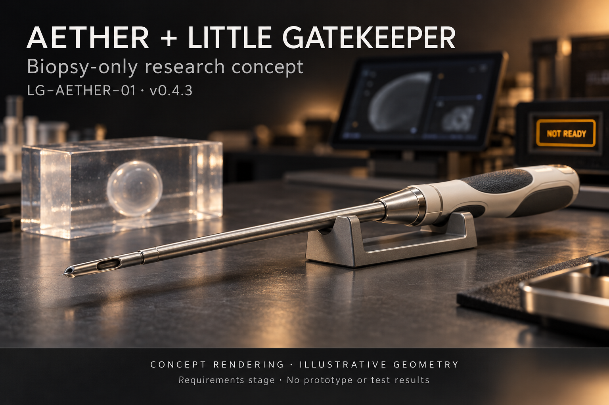

# AETHER + Little Gatekeeper

**Biopsy-only research concept — LG-AETHER-01 · v0.4.3**

A concept presentation of AETHER and Little Gatekeeper, illustrated with a biopsy instrument, a laboratory phantom, and a readiness display.

**Status: requirements stage. No prototype or test results.**

The artwork shows illustrative geometry for a nonclinical research concept. It does not establish device safety, clinical performance, or readiness for use on people.

Shared by Ray Peloquin.
